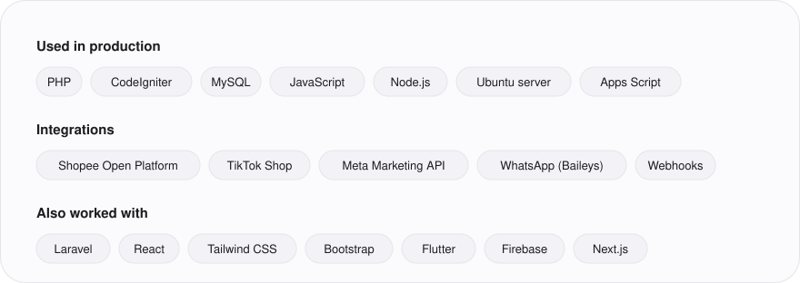
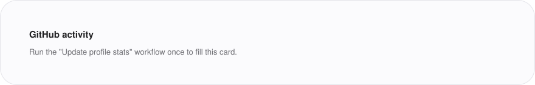

<picture>
  <source media="(prefers-color-scheme: dark)" srcset="assets/header-dark.svg">
  
</picture>

I build and run the internal systems of a multi-brand beauty company in Indonesia: the ERP, Shopee and TikTok Shop integrations, Meta Ads reporting and the server it all runs on. Every report is reconciled against its source until the difference is zero.

**Portfolio** [muftzyxslwly.my.id](https://muftzyxslwly.my.id) &nbsp;|&nbsp; **LinkedIn** [muftiarifudintaqy](https://www.linkedin.com/in/muftiarifudintaqy) &nbsp;|&nbsp; **Email** [muftiarifudintaqy0@gmail.com](mailto:muftiarifudintaqy0@gmail.com) &nbsp;|&nbsp; **Instagram** [@xyzmuff_](https://www.instagram.com/xyzmuff_/)

### Selected work

| Project | What it does | Stack |
|---|---|---|
| [Montera ERP](https://muftzyxslwly.my.id/case-erp.html) | Orders, waybills, payouts, stock, profit, warehouse and HR for two brands, checked against the marketplaces every day | PHP, CodeIgniter, MySQL |
| [Ads Reporting Automation](https://muftzyxslwly.my.id/case-ads.html) | Daily reporting for 40+ Meta ad accounts, synced with the team's Google Sheets | Meta Marketing API, Apps Script |
| [Affiliate WhatsApp Inbox](https://muftzyxslwly.my.id/case-inbox.html) | One web inbox for six affiliate WhatsApp numbers, with an audit log | Node.js, Baileys, MySQL |
| [JNE Attendance System](https://github.com/NabihanN06/jne_attandance) | Team project: face and GPS attendance app; I built the Flutter employee app | Flutter, Firebase |

The ERP, ads and inbox systems are private company code. The case studies explain how they work.

<picture>
  <source media="(prefers-color-scheme: dark)" srcset="assets/stack-dark.svg">
  
</picture>

<picture>
  <source media="(prefers-color-scheme: dark)" srcset="assets/stats-dark.svg">
  
</picture>
