


<a href="https://muftzyxslwly.my.id">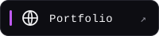</a>

  


<a href="https://muftzyxslwly.my.id/case-erp.html">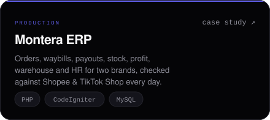</a>
<a href="https://muftzyxslwly.my.id/case-ads.html">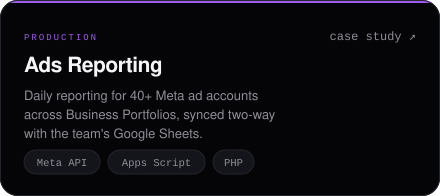</a>
<a href="https://muftzyxslwly.my.id/case-inbox.html"></a>
<a href="https://github.com/NabihanN06/jne_attandance"></a>

ERP, ads and inbox are private company systems. The case studies explain how they work.

  



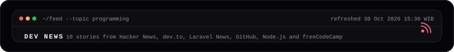

<!--NEWS:START-->
<!--NEWS:END-->

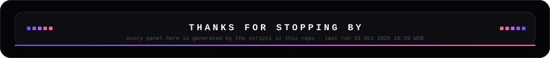

