  

ERP, ads and inbox are private company systems. The case studies explain how they work.

  

<!--NEWS:START-->
<table>
<tr><td width="50%" valign="top"><code>DEV</code> 6m ago <a href="https://dev.to/sebastian_balog_c88dc2913/how-to-run-multiple-cursor-accounts-at-once-on-mac-and-windows-1knk"><b>How to Run Multiple Cursor Accounts at Once on Mac and Windows</b></a> &amp;lt;p&amp;gt;&amp;lt;em&amp;gt;Disclosure up front: I make &amp;lt;a href=&quot;https://cursorsessions.com/&quot; rel=&quot;noopener noreferrer&quot;&amp;gt;Sessions Pro for…</td><td width="50%" valign="top"><code>DEV</code> 6m ago <a href="https://dev.to/jeff_pdc/dead-stubs-finding-mock-mappings-no-test-actually-uses-1k7c"><b>Dead Stubs: Finding Mock Mappings No Test Actually Uses</b></a> &amp;lt;p&amp;gt;&amp;lt;strong&amp;gt;Quick answer:&amp;lt;/strong&amp;gt; Mock mappings accumulate like any other code, and over time a test suite builds up dead stubs,…</td></tr>
<tr><td width="50%" valign="top"><code>HN</code> 34m ago <a href="https://www.workatastartup.com/jobs/98722"><b>Wasmer (YC S19) Is Hiring OS/Hypervisor Experts in Europe</b></a> Article URL: https://www.workatastartup.com/jobs/98722 Comments URL: https://news.ycombinator.com/item?id=50300643 Points: 0 # Comments: 0</td><td width="50%" valign="top"><code>HN</code> 6h ago <a href="https://github.com/picocss/pico/discussions/754"><b>Pico CSS is no longer maintained</b></a> Article URL: https://github.com/picocss/pico/discussions/754 Comments URL: https://news.ycombinator.com/item?id=50298964 Points: 104 # Comments: 39</td></tr>
<tr><td width="50%" valign="top"><code>FREECODECAMP</code> 10h ago <a href="https://www.freecodecamp.org/news/ai-search-visibility/"><b>How AI-Powered Search Works: A Guide for Devs on AI Visibility</b></a> Searched worked in a familiar way for decades: you'd type in your query, get back a list of pages, and choose one to click on. Behind the scenes,…</td><td width="50%" valign="top"><code>FREECODECAMP</code> 11h ago <a href="https://www.freecodecamp.org/news/learn-real-world-penetration-testing-hands-on-ethical-hacking-crash-course/"><b>Learn Real-World Penetration Testing: Hands-On Ethical Hacking Crash Course</b></a> Understanding how malicious actors infiltrate networks is the first step to building resilient infrastructure. To help developers and aspiring…</td></tr>
<tr><td width="50%" valign="top"><code>NODE.JS</code> 12h ago <a href="https://nodejs.org/en/blog/release/v27.0.0-alpha.0.0.0"><b>Node.js 27.0.0-alpha.0.0.0 (Alpha)</b></a> </td><td width="50%" valign="top"><code>LARAVEL</code> 1d ago <a href="https://laravel-news.com/pollora-wordpress-laravel?utm_medium=feed&amp;utm_source=feedpress.me&amp;utm_campaign=Feed%3A+laravelnews"><b>Pollora: Run WordPress Inside a Laravel Application</b></a> Pollora runs WordPress inside Laravel, with Route::wp() routing on conditional tags, Blade themes, and PHP attributes for post types and hooks.…</td></tr>
<tr><td width="50%" valign="top"><code>NODE.JS</code> 2d ago <a href="https://nodejs.org/en/blog/release/v24.22.2"><b>Node.js 24.22.2 (LTS)</b></a> </td><td width="50%" valign="top"><code>GITHUB</code> 2d ago <a href="https://github.blog/news-insights/company-news/github-universe-2026-evolving-every-layer-of-the-stack/"><b>GitHub Universe 2026: Evolving every layer of the stack</b></a> Today, we laid out our vision for GitHub as the most comprehensive, end-to-end software delivery system in the world. The post GitHub Universe…</td></tr>
</table>
<!--NEWS:END-->

